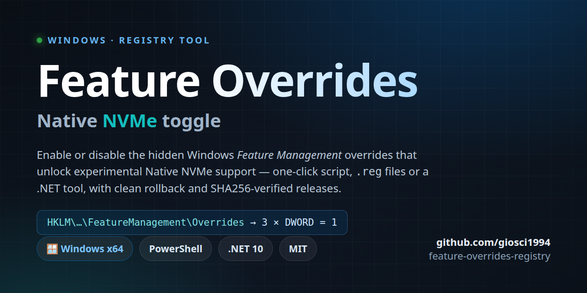

# 💽 Feature Overrides — Native NVMe toggle (Windows)

**Enable or disable the hidden Windows *Feature Management* overrides that unlock
experimental "Native NVMe" support — via one-click script, `.reg` files or a small
.NET tool, with a clean rollback and SHA256-verified releases.**

### 🌐 [giosci1994.github.io/feature-overrides-registry](https://giosci1994.github.io/feature-overrides-registry/)

<p align="center">
  <a href="https://github.com/giosci1994/feature-overrides-registry/actions/workflows/build.yml"></a>
  <a href="https://github.com/giosci1994/feature-overrides-registry/releases/latest"></a>
  
  
  <a href="LICENSE"></a>
  <a href="https://buymeacoffee.com/giosci1994u"></a>
</p>

<p align="center">
  
</p>

> ⚠️ **Unofficial / experimental on Windows 11.** These overrides modify the
> Windows Registry under `HKLM`. Microsoft officially supports "Native NVMe" **only
> on Windows Server 2025** (October 2025 update or later). On Windows 11 this is an
> unofficial, experimental use. **Create a restore point / backup first.**

---

## 🔧 What it does

The tool creates (or removes) three **DWORD (32-bit)** values in the registry:

```
HKEY_LOCAL_MACHINE\SYSTEM\CurrentControlSet\Policies\Microsoft\FeatureManagement\Overrides
```

| Value name | Data |
|------------|------|
| `735209102` | `1` |
| `1853569164` | `1` |
| `156965516` | `1` |

These keys are commonly used as *feature overrides* to enable a **"Native NVMe"**
mode in the driver/storage stack. On many Windows client installs, NVMe SSDs are
surfaced through a SCSI/Storport path (e.g. via `disk.sys`) rather than a more
direct NVMe path. Turning on this hidden feature can make NVMe disks appear under
**"Storage disks"** and use a dedicated NVMe driver path, with potential gains in
some metrics (IOPS, reads/writes at certain block sizes) — but with **compatibility
caveats**.

### ⚠️ Important warnings

- **Back up / create a restore point** before touching the registry.
- On some systems anomalies have been reported (duplicate drives, unrecognized
  drives, management tools that "lose" the NVMe, etc.).
- "Native NVMe" is officially supported **only on Windows Server 2025** (October
  update or later). On Windows 11 it is unofficial / experimental.

---

## ✅ Requirements

- **Windows** (x64) with **administrator privileges** (all changes are under `HKLM`).
- For the `.NET` tool: nothing to install — release binaries are self-contained. To
  build from source you need the **.NET 10 SDK**.

---

## 🚀 Usage

> Everything requires **administrator privileges** (HKLM).

### 1) One-click (recommended)

`scripts/installer.ps1` — interactive menu (Enable / Disable / Status / optional Fix
Safe Mode). Run from an **elevated** PowerShell:

```powershell
powershell -ExecutionPolicy Bypass -File .\scripts\installer.ps1
```

### 2) PowerShell scripts (non-interactive)

```powershell
# Enable
powershell -ExecutionPolicy Bypass -File .\scripts\set-overrides.ps1
# Disable
powershell -ExecutionPolicy Bypass -File .\scripts\remove-overrides.ps1
# Status
powershell -ExecutionPolicy Bypass -File .\scripts\status-overrides.ps1
```

### 3) `.reg` files

- `reg/feature-overrides-enable.reg`
- `reg/feature-overrides-disable.reg`

### 4) .NET tool (exe)

Download the release artifact (or build it), then:

```powershell
FeatureOverridesSetter.exe status
FeatureOverridesSetter.exe enable
FeatureOverridesSetter.exe disable
```

---

## 🏗️ Build & Release (GitHub Actions)

- **CI build** on push to `main` / PR → [`.github/workflows/build.yml`](.github/workflows/build.yml)
- **Automated release** on tag `v*` (e.g. `v1.0.0`) → [`.github/workflows/release.yml`](.github/workflows/release.yml)

Each release publishes:

- `FeatureOverridesSetter.exe` — self-contained Windows x64 executable
- `FeatureOverridesSetter-win-x64-<tag>.zip` — zipped binaries
- `feature-overrides-registry-<tag>.zip` — packaged sources
- `SHA256SUMS.txt` — checksums of every asset
- `VERIFY.ps1` — automatic verification script

```powershell
git tag v1.0.0 && git push origin v1.0.0   # the Action builds & publishes
```

---

## 🔐 Integrity verification (SHA256)

Every official release includes `SHA256SUMS.txt` and `VERIFY.ps1`, so you can
confirm the downloaded files have not been altered, corrupted or tampered with.

1. From the release, download `FeatureOverridesSetter.exe`, `SHA256SUMS.txt` and
   `VERIFY.ps1`.
2. Put all files **in the same folder** (e.g. `Downloads\FeatureOverrides`).
3. Open PowerShell in that folder and run:

   ```powershell
   powershell -ExecutionPolicy Bypass -File .\VERIFY.ps1
   ```

---

## ☕ Support

If this tool is useful to you, you can buy me a coffee.

<a href="https://buymeacoffee.com/giosci1994u"></a>

## 📄 License

[GNU GPL-3.0](LICENSE) © Giovanni La Cascia
